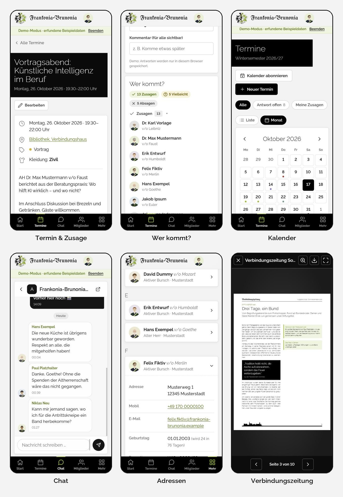
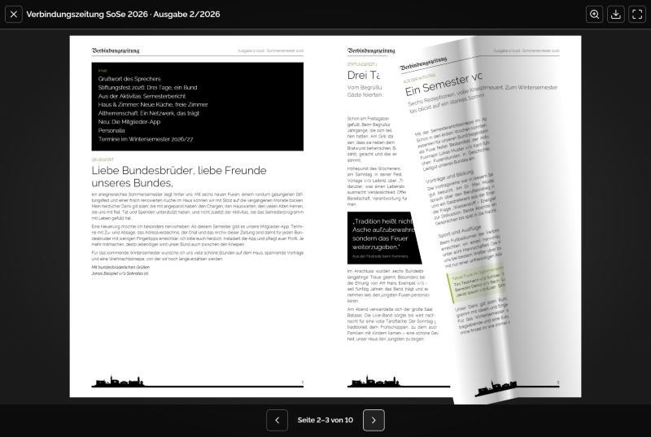
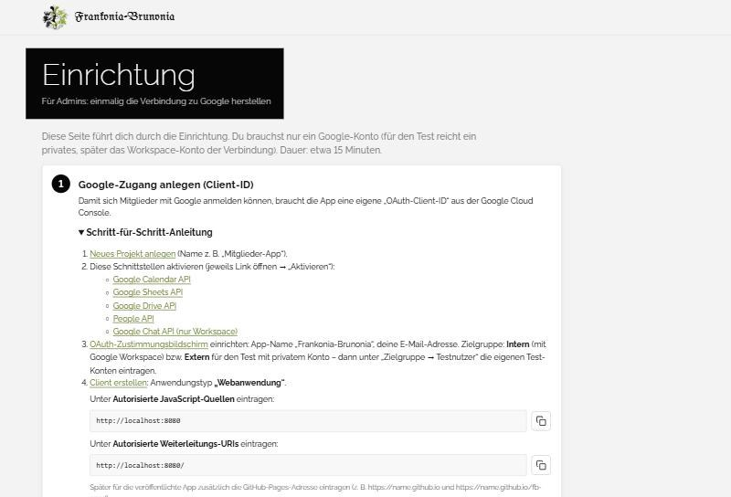

# Frankonia-Brunonia – Mitglieder-App

Die App für alle Bundesbrüder: **Termine mit Zu- und Absage, Mitgliederprofile, Geburtstage, Chat, Adressverzeichnis, den Bundesboten (Zeitung der Verbindung) zum Durchblättern, die Liedermappe mit allen Noten, Fotogalerie, News und Forum**. Sie lässt sich auf iPhone, Android und PC installieren, ohne App-Store. Alle Daten liegen im **Google Workspace der Verbindung**; angemeldet wird einmalig mit dem Verbindungskonto.

**Grundsatz:** Die App dient der Information und dem Austausch. Gemeinsame Daten zeigt sie nur an und ändert sie nie. Jedes Mitglied ändert ausschließlich seine eigenen Daten: die eigene Zu-/Absage, das eigene Profil, eigene Forumsbeiträge, die eigene Datenschutz-Einwilligung, eigene Chat-Nachrichten und neue Unterhaltungen mit Personen (siehe [Schreibschutz](#schreibschutz)).



## Funktionen

| Bereich | Umsetzung |
|---|---|
| **Profile** | Foto und Name aus dem Google-Konto (Workspace-Verzeichnis). Dazu Kneipname, Status, Rezeption, Ämter, Studium/Beruf, aktuelle bzw. letzte Tätigkeit, Wohnort, „Über mich“ und **was man jüngeren Bundesbrüdern anbieten kann** (Praktika, Mentoring …; eigener Filter „Angebote für Jüngere“). Diese Angaben speichert jeder in einer kleinen Datei im **eigenen** Google Drive. |
| **Abgleich mit dem Adressverzeichnis** | Oben im Profil: „Bitte teile uns Adressänderungen per E-Mail mit“ mit Knopf, der die E-Mail an das Postfach für Adressänderungen öffnet. „Mein Profil“ vergleicht außerdem Anschrift und Stammdaten mit dem Adressverzeichnis; „Aus Adressverzeichnis übernehmen“ füllt die Felder wieder mit dessen Stand. Bei Abweichungen bereitet die App eine E-Mail an das Postfach für Adressänderungen vor. Profil und Adressverzeichnis bleiben bewusst getrennt. |
| **Kalender** | Google Kalender der Verbindung, als Liste und Monatsansicht, mit Filtern und farbigen Kategorien. Abo im eigenen Google Kalender, Export als `.ics` für Apple und Outlook. |
| **Zu- und Absagen** | Normale Google-Kalender-Antwort (Ja/Vielleicht/Nein, Gäste, Kommentar) im eigenen Kalender. „Wer kommt?“ zeigt Fotos. Jeder Termin enthält einen Link, der direkt in die App führt, auch im exportierten Kalender. |
| **Geburtstage** | Die nächsten drei Geburtstage auf der Startseite, aus dem Adressverzeichnis. |
| **Chat** | Google Chat in der App: private Nachrichten (aus dem Profil oder „Neue Nachricht“), eigene Gruppen, Räume der Verbindung; Personen hinzufügen. |
| **Benachrichtigungen** | Nur wenn man sie einschaltet: Zahlen am Chat und an „Mehr“, „Neu“ an News, Hinweise und – solange die App läuft – Mitteilungen des Systems. Bei geschlossener App über die App „Google Chat“; die Redaktion kann neue News dort ankündigen. |
| **Adressverzeichnis** | Google-Tabelle, nur lesbar. Suche, anrufen, E-Mail, Karte, in Kontakte übernehmen (vCard). |
| **Bundesbote** | Die Zeitung der Verbindung: PDFs aus einem Drive-Ordner mit allen Ausgaben, immer eine Seite (Doppelseiten aus Scans werden geteilt), **realistische Umblätter-Animation**, Zoom, offline verfügbar. |
| **Liedermappe** | Noten aus einem Drive-Ordner (PDFs oder Scans), Rubriken aus Unterordnern, Suche nach Titel oder Liednummer, Blättern wie beim Bundesboten. Der Bildschirm bleibt beim Singen an; auf Wunsch liegt die ganze Mappe offline auf dem Gerät. |
| **Weitere Links** | Schaltflächen im Schnellzugriff zu weiteren Angeboten der Verbindung, z. B. dem Wiki (`links` in `config.js`). |
| **Fotogalerie** | Fotos aus einem festen Drive-Ordner. Jeder Unterordner ist ein Album (z. B. „2026-06 Stiftungsfest“), Vollbild mit Wischen. |
| **News** | Meldungen mit Bildern. Admins und die Redaktion schreiben sie direkt in der App (als eigene Beiträge, wie im Forum); Meldungen aus einer Google-Tabelle „News“ erscheinen zusätzlich. |
| **Forum** | Kategorien, Themen und Antworten. Jeder Beitrag liegt im eigenen Drive des Verfassers, nur er kann ihn ändern oder löschen. |
| **Schriftgröße** | Klein, Normal, Groß und Sehr groß, damit auch Menschen mit schlechten Augen auf dem Handy alles lesen können. Einstellbar unter Mehr. |
| **Datenschutz** | Beim ersten Öffnen: Datenschutzerklärung und zwei getrennte Einwilligungen (vereinsübliche Zwecke; Weitergabe an die Deutsche Sängerschaft), jeweils Ja oder Nein. Unter Mehr → Datenschutz jederzeit änderbar. Jede Entscheidung liegt nachweisbar im eigenen Drive und wird in einer vertraulichen Sammeltabelle der Verantwortlichen zusammengeführt. |
| **Geräte** | Handy, Phablet und Tablet in jeder Ausrichtung sowie PC. Auf Touch-Geräten gibt es immer die große Leiste unten, ab iPad-Breite zweispaltig, mit Schutzabständen für Kameraaussparungen im Querformat. |
| **Gestaltung** | Im Stil der Website: hellgrau, schwarze Titelkästen, Raleway, Grün aus dem Wappen. Wappen klein oben, Skyline unten. |



## Schreibschutz

Die App ändert **keine** gemeinsamen Daten, weder Termine noch News, Adressen, Zeitungen, Fotos oder fremde Profile und Beiträge. Das ist dreifach abgesichert:

1. **Google-Freigaben:** Mitglieder haben auf Kalender, Tabellen und Ordner nur Leserechte.
2. **Angefragte Berechtigungen:** Die App fragt bei Google für Drive nur „lesen“ und „eigene, von der App angelegte Dateien“ an (`drive.readonly` und `drive.file`), für Tabellen gar keine Schreibberechtigung. Damit kann sie fremde Dateien technisch nicht ändern.
3. **Sperre im Code** (`js/google/guard.js`): Jede ändernde Anfrage wird geprüft, bevor sie das Gerät verlässt. Erlaubt sind nur die eigene Zu-/Absage im eigenen Kalender, eigene Dateien (Profil, Forumsbeiträge, Zusagen ohne Einladung, News der Redaktion, Einwilligung), eigene Chat-Nachrichten sowie neue Unterhaltungen mit Personen und das Hinzufügen von Personen. Alles andere wird blockiert.

Ausnahmen gibt es zwei, beide betreffen nur eigene Dateien:
- Der Knopf **„Fehlendes neu anlegen“** in der Einrichtung ist nur für Admins sichtbar und legt nur an, was noch nicht verbunden ist – ausschließlich neue Dateien im eigenen Drive. Verbundenes (vorhandener Kalender, Mitgliederliste, Ordner) wird nie verändert oder neu freigegeben.
- Die **vertrauliche Einwilligungsliste** darf nur das Konto aktualisieren, dem sie gehört und das sie mit der App angelegt hat (die Datenschutz-Verantwortlichen).

Gepflegt werden die gemeinsamen Daten direkt bei Google: Termine im Google Kalender, News und Adressen in Google Tabellen, Zeitungen und Fotos in Google Drive.

## Schnellstart

**Ansehen ohne Einrichtung** (Demo mit erfundenen Daten):

```bash
python tools/serve.py
```

→ http://localhost:8080 öffnen → „Demo mit Beispieldaten ansehen“.

**Einrichten mit Google** (Prototyp mit eigenem Konto, später Workspace): Schritt für Schritt in **[docs/EINRICHTUNG.md](docs/EINRICHTUNG.md)**. Kurz:

1. In der Google Cloud Console eine **OAuth-Client-ID** (Webanwendung) anlegen.
2. Projekt auf **GitHub** hochladen und GitHub Pages einschalten (veröffentlicht automatisch). Kostenlos geht das mit einem öffentlichen Repository; mit einem privaten nur mit kostenpflichtigem GitHub-Tarif.
3. In der App unter **Einrichtung**: Client-ID eintragen, anmelden, Datenschutz-Angaben (Verein, Anschrift, Kontakt) ergänzen. Was es schon gibt (Kalender, Mitgliederliste, Ordner), unter **„1. Vorhandenes verbinden“** eintragen, **„Verbindung prüfen“** (warnt u. a. vor „Jeder mit dem Link“), dann **„2. Fehlendes neu anlegen“** – z. B. News-Tabelle und vertrauliche Einwilligungsliste. Ohne Vorhandenes entsteht alles neu.
4. `config.js` herunterladen und im Repository ersetzen.
5. Für die Mitglieder: QR-Code und Anleitung mit `python tools/make_anleitung.py https://…` erzeugen (siehe unten).



## Für die Mitglieder: Link, QR-Code, Anleitung

- **Adresse der App:** <https://janbellin-pixel.github.io/fb-app/> (Repository: <https://github.com/janbellin-pixel/fb-app>)
- **[docs/Anleitung-Mitglieder-App.pdf](docs/Anleitung-Mitglieder-App.pdf)** – zwei Seiten zum Verschicken oder Ausdrucken: QR-Code, Anmeldung, Datenschutz-Abfrage, Installation auf iPhone und Android, „Was finde ich wo?“.
- **[docs/qr-code.png](docs/qr-code.png)** – der QR-Code allein, z. B. für Aushang oder Rundmail.
- Neu erzeugen, z. B. nach Änderungen an der App oder mit Ansprechpartner (Domain und Ansprechpartner optional):

```bash
python tools/make_anleitung.py https://janbellin-pixel.github.io/fb-app/ --domain frankonia-brunonia.de --kontakt "Name, Telefon"
```

- In der App selbst gibt es unter **Mehr → App installieren** ebenfalls einen QR-Code zum Zeigen und Teilen.

## Dokumentation

- [docs/EINRICHTUNG.md](docs/EINRICHTUNG.md) – Einrichtung Prototyp und Echtbetrieb, Daten pflegen, Fehlerbehebung
- [docs/MITGLIEDER-ANLEITUNG.md](docs/MITGLIEDER-ANLEITUNG.md) – Kurzanleitung für die Mitglieder (Textfassung der PDF)
- [docs/ARCHITEKTUR.md](docs/ARCHITEKTUR.md) – technischer Aufbau, Datenmodell, Schreibschutz, Store-Apps
- [docs/ENTWICKLUNG.md](docs/ENTWICKLUNG.md) – Leitfaden zur Weiterentwicklung (auch mit KI): Aufbau, Abläufe, Schnittstellen, Tests, typische Aufgaben, offene Punkte
- [docs/ENTSCHEIDUNGEN.md](docs/ENTSCHEIDUNGEN.md) – alle Entwicklungsentscheidungen mit Begründung
- [AGENTS.md](AGENTS.md) / [CLAUDE.md](CLAUDE.md) – verbindliche Kurzregeln für KI-Assistenten
- [apps-script/Automatik.gs](apps-script/Automatik.gs) – optional für den Kalender-Inhaber: trägt in neue Termine automatisch den App-Link und die Mitglieder-Gruppe ein
- [apps-script/Einwilligungen.gs](apps-script/Einwilligungen.gs) – optional für die Datenschutz-Verantwortlichen: sammelt die Einwilligungen stündlich in die vertrauliche Tabelle

## Technik in Kürze

Progressive Web App ohne Build-Schritt und ohne eigenen Server · Google Calendar, Sheets (nur lesen), Drive, People und Chat API · OAuth 2.0 · Schreibschutz im Code · offline-fähig (Service Worker) · PDF.js + StPageFlip · Schriften lokal (DSGVO) · Demo-Modus · automatische Tests gegen einen Nachbau der Google-APIs (`tests/google-mock.html`, 127 Prüfungen, davon viele zu Schreibschutz und Einwilligungen).

## Lizenzen

App-Code: für die Frankonia-Brunonia erstellt. Mitgelieferte Bibliotheken und Schriften: PDF.js (Apache 2.0), StPageFlip (MIT), qrcode-generator (MIT), Raleway und UnifrakturMaguntia (SIL Open Font License); Lizenztexte in `vendor/` und `assets/fonts/`. Symbole angelehnt an Feather Icons (MIT). Alle Personen, Termine, Fotos und Zeitungsinhalte im Demo-Modus sind frei erfunden.
